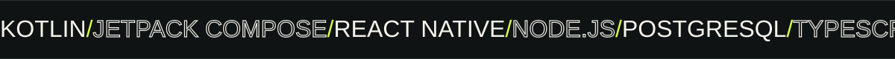

 

  

 

<!-- ================= ABOUT ================= -->

##  About

**Where creativity meets code.**

I'm a **Computer Science student at Strathmore University** who loves building user-friendly platforms, from native Android apps to clean, responsive web experiences.

I work across **Kotlin, Jetpack Compose, React Native, Node.js and PostgreSQL**, and I'm exploring how AI can make the products I build smarter and more useful.

 

<!-- ================= WORK ================= -->

##  Selected Work

Click a project to expand it.

<b>01 &nbsp;&nbsp; MotionIQ</b>

 

AI-powered fitness app that analyzes activity data to give personalized performance insights, coaching and route recommendations. Starting with cycling.

<b>02 &nbsp;&nbsp; JK Bloodbank</b>

 

Full-stack blood donation and supply-chain platform that connects eligible donors to hospitals in real time, with distance-ranked donor matching and GPS cold-chain temperature and custody monitoring.

<b>03 &nbsp;&nbsp; Intelligent Stakeholder Matching</b>

 

Hybrid recommendation system (content-based and collaborative filtering) for matching people in mentorship and professional networking contexts. Capstone project at Strathmore University.

<b>04 &nbsp;&nbsp; Kutana</b>

 

Offline-first event safety app built on a Bluetooth LE mesh: nearby group finding, local message relay and cryptographically gated alerts.

 

<!-- ================= TOOLKIT ================= -->

##  Toolkit

<table>
  <tr>
    <td width="170"> <b>Mobile</b></td>
    <td>
      
      
      
      
      
    </td>
  </tr>
  <tr>
    <td> <b>Web</b></td>
    <td>
      
      
      
      
      
      
      
    </td>
  </tr>
  <tr>
    <td> <b>Data and backend</b></td>
    <td>
      
      
      
      
      
      
      
    </td>
  </tr>
  <tr>
    <td> <b>Tools and cloud</b></td>
    <td>
      
      
      
      
      
      
    </td>
  </tr>
</table>

 

<!-- ================= ACTIVITY ================= -->

##  Activity

 

 

 

<!-- ================= CONTACT ================= -->

## Let's build something great.

