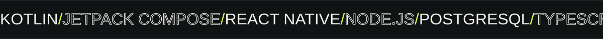

 

  

 

<!-- ================= ABOUT ================= -->

##  About

**Where creativity meets code.**

I'm a **Computer Science student at Strathmore University** who loves building user-friendly platforms, from native Android apps to clean, responsive web experiences.

I work across **Kotlin, Jetpack Compose, React Native, Node.js and PostgreSQL**, and I'm exploring how AI can make the products I build smarter and more useful.

 

<!-- ================= WORK ================= -->

##  Selected Work

Click a project to expand it. Every project below is live or has a demo.

<b>01 &nbsp;&nbsp; Haven</b>

 

A privacy-focused AI companion prototype with ephemeral conversations, sentiment analysis, optional mood check-ins, and mental health resource links. The wellness features are project capabilities, not clinical guarantees.

[Source code](https://github.com/K6EDWIN/Haven) &nbsp;·&nbsp; [Live site (Render)](https://haven-7bp5.onrender.com/)

<b>02 &nbsp;&nbsp; Chess</b>

 

A Python chess engine with a Pygame interface, bitboard move generation, full chess rules, and a Minimax AI opponent.

[Source code](https://github.com/K6EDWIN/Chess) &nbsp;·&nbsp; [Live demo (Replit)](https://replit.com/@edkyle06/Chess)

<b>03 &nbsp;&nbsp; Quickmatatu</b>

 

A React Native matatu transport prototype for commuters and drivers, with route, booking, and arrival-time features.

[Source code](https://github.com/K6EDWIN/Quickmatatu) &nbsp;·&nbsp; [Live site](https://quickmatatu.vercel.app)

<b>04 &nbsp;&nbsp; Fort Sentinel Password Manager</b>

 

A local-first password vault that encrypts data on the user's device using PBKDF2 key derivation and AES-GCM authenticated encryption.

[Source code](https://github.com/K6EDWIN/Password-Manager) &nbsp;·&nbsp; [Live site](https://fortsentinel.vercel.app)

<b>05 &nbsp;&nbsp; PrideConnect</b>

 

A mentorship and professional networking app with explainable stakeholder recommendations, member profiles, connections, events, and career opportunities. Built on a hybrid recommendation system (content-based and collaborative filtering). This is a student capstone project, not an official Kenya Airways service.

[Source code](https://github.com/K6EDWIN/Intelligent-stakeholder-matching) &nbsp;·&nbsp; [Live site](https://intelligent-stakeholder-matching.vercel.app)

<b>06 &nbsp;&nbsp; JK Bloodbank</b>

 

A donor-to-hospital matching and blood supply-chain platform with distance-ranked donor matching, GPS cold-chain monitoring, and emergency alerts.

[Source code](https://github.com/K6EDWIN/JK-Bloodbank) &nbsp;·&nbsp; [Live site](https://jk-bloodbank.vercel.app)

<b>07 &nbsp;&nbsp; Kutana</b>

 

An offline-first event safety and group-finding app that uses phone-to-phone proximity (Bluetooth LE mesh) to help people find their group and relay security alerts.

[Source code](https://github.com/K6EDWIN/kutana) &nbsp;·&nbsp; [Backend](https://kutana-backend.vercel.app) &nbsp;·&nbsp; [Android releases](https://github.com/K6EDWIN/kutana/releases/latest)

<b>08 &nbsp;&nbsp; MotionIQ</b>

 

A cycling activity app that imports GPX, FIT, or TCX files and produces ride statistics, maps, and AI-generated insights.

[Source code](https://github.com/K6EDWIN/MotionIQ) &nbsp;·&nbsp; [Web app / backend](https://motioniq-two.vercel.app) &nbsp;·&nbsp; [Android releases](https://github.com/K6EDWIN/MotionIQ/releases/latest)

<b>09 &nbsp;&nbsp; Whose Like?</b>

 

A real-time party game where players guess who liked, reposted, or saved a video, with phone-based play and a shared room display.

[Source code](https://github.com/K6EDWIN/whose) &nbsp;·&nbsp; [Live site](https://whose-eta.vercel.app)

<b>10 &nbsp;&nbsp; MediView3D</b>

 

An educational anatomy visualization project combining graphics algorithms, an OpenGL desktop prototype, and a browser-based 3D studio. It is an educational prototype, not a medical tool.

[Source code](https://github.com/K6EDWIN/MediView3D) &nbsp;·&nbsp; [Live site](https://mediview-liard.vercel.app)

<b>11 &nbsp;&nbsp; FabricStudio</b>

 

A sofa and upholstery preview tool with a rotatable 3D model, fabric options, and a way to send selections to the workshop. On-screen fabric textures are illustrative.

[Source code](https://github.com/K6EDWIN/FabricStudio) &nbsp;·&nbsp; [Live site](https://fabric-studio-lyart.vercel.app)

<b>12 &nbsp;&nbsp; The Ultimate Hangout</b>

 

A Nairobi game-night platform for events, tournaments, ticket booking, check-in, and score tracking.

[Source code](https://github.com/K6EDWIN/The-ultimate-hangout) &nbsp;·&nbsp; [Live site](https://the-ultimate-hangout.vercel.app)

 

<!-- ================= TOOLKIT ================= -->

##  Toolkit

<table>
  <tr>
    <td width="170"> <b>Mobile</b></td>
    <td>
      
      
      
      
      
    </td>
  </tr>
  <tr>
    <td> <b>Web</b></td>
    <td>
      
      
      
      
      
      
      
    </td>
  </tr>
  <tr>
    <td> <b>Data and backend</b></td>
    <td>
      
      
      
      
      
      
      
    </td>
  </tr>
  <tr>
    <td> <b>Tools and cloud</b></td>
    <td>
      
      
      
      
      
      
    </td>
  </tr>
</table>

 

<!-- ================= ACTIVITY ================= -->

##  Activity

 

 

 

<!-- ================= CONTACT ================= -->

## Let's build something great.

